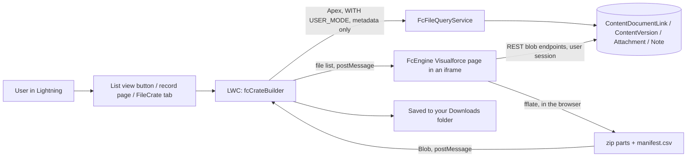

# FileCrate

Open source bulk file download for Salesforce. Select records, click once, and get every file on them in one tidy zip with a CSV map.

MIT licensed. Runs entirely inside your Salesforce org and your browser. No external servers.

## What it does

- Downloads **Files, classic Attachments, classic Notes and Enhanced Notes** from the records you pick.
- Downloads org-wide files too: **Documents, Library files, Static Resources and Event Log files**.
- Ways to pick records:
  - a **Download Files** button on list views
  - a component on **record pages**, which can also include files from child and grandchild records
  - the **FileCrate tab**: list views from one or several objects, a name search, or a SOQL query
- Saves as **one or more zips**, or (in Chrome and Edge) **straight into a folder** on your computer.
- Adds a `manifest.csv` to every zip or folder: record Id and name, object, file Id and name, type, size, created date and path.
- Folder layouts: one folder per record, object then record, or flat.
- Filters: file type, created date range, size cap, latest version only or every version.
- File name patterns with tokens such as `{RecordName}_{Title}.{ext}`.
- Shows the file count and total size before you download, and splits large runs into several zips.
- Lists anything it could not fetch in `errors.csv`. Nothing is skipped silently.
- Keeps a **history** of runs, each with a "Run again" action.

Users only ever get files they can already open in Salesforce. All Apex runs `with sharing` and in user mode.

## How it works



Apex only returns file metadata, never file bytes, so Apex heap limits never cap the zip size. The browser fetches the bytes and builds the zip. See [docs/architecture.md](docs/architecture.md).

## Install from source

You need the [Salesforce CLI](https://developer.salesforce.com/tools/salesforcecli) and an org you are logged in to.

```bash
git clone https://github.com/aroramit17/salesforce-bulk-file-download.git
cd salesforce-bulk-file-download
sf project deploy start --target-org <your-org-alias>
sf org assign permset --name FileCrate_User --target-org <your-org-alias>
```

Give `FileCrate_Admin` to admins instead of `FileCrate_User`. It adds SOQL mode, the FileCrate Setup tab, and sight of every user's job history.

### Requirements

- Lightning Experience on a desktop browser.
- Users need the **API Enabled** permission, because the browser reads file bytes through the Salesforce REST API. Without it FileCrate shows a clear message and downloads nothing.
- Professional Edition orgs without API access are not supported.

### Set up the three entry points

1. **FileCrate tab**: add the FileCrate tab to an app, or open it from the App Launcher.
2. **Record page**: in Lightning App Builder, drag **FileCrate Record Files** onto a record page. To offer files from related records, fill in **Related records to offer** with child relationship names, one or two levels deep, separated by commas. Example: `Contacts, Opportunities, Opportunities.OpportunityLineItems`.
3. **List view button**: the package ships a **Download Files** button for Account, Contact, Opportunity and Case. Add it to the list view: Setup > Object Manager > the object > List View Button Layout > edit > add **Download Files**.

For any other object, create a List Button with display type "List Button", "Display Checkboxes" ticked, content source "URL", and this URL (replace `My_Object__c`):

```
/flow/FileCrate_Download_From_List?objectApiName=My_Object__c&retURL=/lightning/o/My_Object__c/list
```

Salesforce passes the ticked record Ids to the flow by itself.

## The FileCrate tab

| Mode | What it does |
|---|---|
| List views | Pick an object and a list view. Add more, from other objects too, and download them together. |
| Search | Search an object by name, tick the records you want. |
| SOQL | Run a `SELECT Id FROM ...` query. Needs the `Fc_Run_SOQL` custom permission (part of `FileCrate_Admin`). Runs with your own access and returns at most 10,000 records. |
| Org files | Documents (by folder), Library files, Static Resources, or Event Log files (by type and date). Event logs need the "View Event Log Files" permission. |
| History | Your last 50 runs. "Run again" restores the selection and options. |

## Save to a folder

In Chrome and Edge the download screen also shows **Save to a folder**. It opens a small FileCrate window where you choose a folder; files are written there directly with no zip and no zip size limit. Each file is still held in browser memory while it is written. Existing files are never overwritten: a clashing name gets ` (2)`. Firefox and Safari do not have the folder picker, so they offer zip only.

## Settings

Edit the `Default` record of the **FileCrate Settings** custom metadata type.

| Field | Default | Meaning |
|---|---|---|
| Max Files Per Zip | 500 | A new zip starts after this many files |
| Max Zip MB | 1500 | A new zip starts before this size is passed (hard ceiling 3500) |
| Include Attachments | on | Classic Attachments ticked by default |
| Include Notes | on | Notes and Enhanced Notes ticked by default |
| Latest Version Only | on | Off includes every version of each file |
| Name Pattern | `{RecordName}_{Title}.{ext}` | Default file name pattern |
| Folder Layout | `PerRecord` | `PerRecord`, `PerObject` or `Flat` |

Name pattern tokens: `{RecordName} {RecordId} {Title} {ext} {FileId} {Object} {CreatedDate} {Version}`.

**FileCrate Object Config** lets you choose which field names a record's folder, per object (for example `AccountNumber` instead of `Name`).

## Limits

- A single file larger than the zip size limit is not zipped. It is listed in `manifest.csv` with a link.
- When a run splits into several zips, your browser may ask once whether to allow multiple downloads.
- Very large runs depend on browser memory. See [docs/limits.md](docs/limits.md).
- Every file costs one API request against your org's daily limit. The FileCrate Setup tab shows whether API access works.

## Development

```bash
npm install
npm test          # Jest: core logic, zip engine, components
npm run build     # regenerates staticresources/fcEngineBundle.js
sf org create scratch -f config/project-scratch-def.json -a fc-dev
sf project deploy start -o fc-dev
sf apex run test -o fc-dev --code-coverage --result-format human --wait 20
sf apex run -o fc-dev -f scripts/seed.apex    # sample data
```

See [CONTRIBUTING.md](CONTRIBUTING.md).

## Roadmap

- Export to SharePoint, OneDrive, Google Drive, Dropbox, S3 and R2, and scheduled exports.
- Unlocked package install link, translations, Experience Cloud.

## License

MIT. The bundled [fflate](https://github.com/101arrowz/fflate) zip library is MIT licensed; its license file ships inside the `fflate` static resource.
